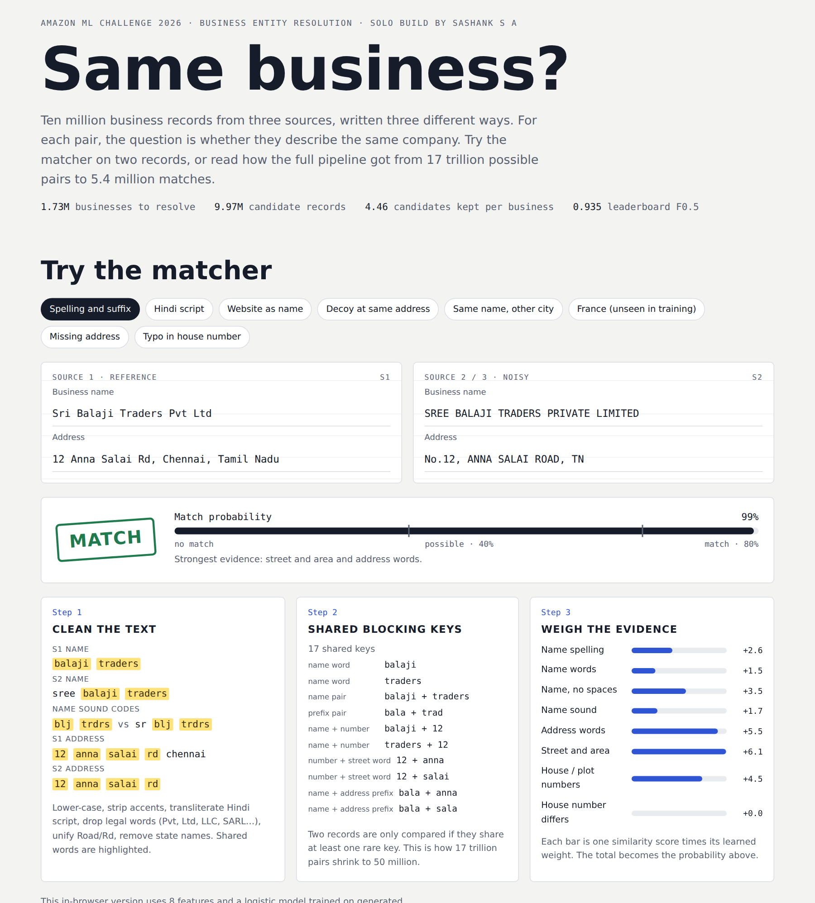
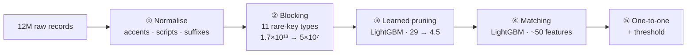

<div align="center">

# 🔗 Amazon ML Entity Resolution

**Matching 1.7 million businesses against 10 million noisy records on a free 2-core CPU.**
My solo solution to the **Amazon ML Challenge 2026**.

[](https://colab.research.google.com/github/Sashank2006/Amazon-ML-Entity-Resolution/blob/main/notebooks/demo_colab.ipynb)


[**▶ Interactive demo**](https://sashank2006.github.io/Amazon-ML-Entity-Resolution/web/) ·
[**Colab demo (2 min)**](https://colab.research.google.com/github/Sashank2006/Amazon-ML-Entity-Resolution/blob/main/notebooks/demo_colab.ipynb) ·
[**How it works**](docs/2-how-it-works.md) ·
[**Results & lessons**](docs/3-results-and-lessons.md)

</div>



---

## ✨ At a glance
| | |
|---|---|
| **Task** | Find every Source-2/3 record that describes the same business as each Source-1 record |
| **Scale** | 1.73 M businesses × 9.97 M records = **1.7 × 10¹³ possible pairs** |
| **Hardware** | Free Google Colab: 2 vCPU, 12.7 GB RAM, **no GPU** |
| **Candidates kept** | **4.46 per business** (from 29 after blocking) |
| **Best leaderboard score** | **0.935** macro F0.5 (top score: 0.991) |
| **Stack** | Python · PyArrow · RapidFuzz · LightGBM · indic-transliteration (all permissive licences) |

## 🧩 The problem in 10 seconds
```text
Source 1:  Sri Balaji Traders Pvt Ltd            12 Anna Salai Rd, Chennai, Tamil Nadu
Source 2:  SREE BALAJI TRADERS PRIVATE LIMITED   No.12, ANNA SALAI ROAD, TN            ← same business
Source 3:  कंसल्टेंसी सर्विसेज प्राइवेट लिमिटेड      No.12, M.G. ROAD, PUNE, MH             ← Hindi script
Source 2:  Pioneer Bakery                        1200 MAPLE AVE, DAYTON, OHIO          ← decoy at a matching address
```
Typos, legal-suffix changes, other scripts, website-style names, missing addresses, look-alike decoys, and a country (France) that appeared only in the test set. → [Full problem description](docs/1-the-problem.md)

## ⚙️ How it works

| Step | Idea in one line | Code |
|---|---|---|
| ① Normalise | Vectorised Arrow text cleaning; Hindi/Telugu/Tamil → Latin; sound codes (`consultancy` = `kansaltensi` = `knsltns`) | [`normalize.py`](src/normalize.py) |
| ② Blocking | Compare only records sharing a *rare* key such as `house number + street word`; keep the top 30 per business | [`blocking.py`](src/blocking.py) |
| ③ Pruning | A small model drops obvious non-matches and keeps 99.5% of reachable true matches | [`pipeline.py`](src/pipeline.py) |
| ④ Matching | String similarities, number matching, frequency and **competition** features ("does another business explain this record better?") | [`features.py`](src/features.py) |
| ⑤ Assign | Each record goes to at most one business, above a tuned threshold | [`pipeline.py`](src/pipeline.py) |

→ [Step-by-step walkthrough with examples](docs/2-how-it-works.md)

## 📊 Results
| Version | Candidates / business | Validation F0.5 | Leaderboard |
|---|---|---|---|
| v1: blocking + one LightGBM | 24.3 | 0.940 | 0.931 |
| v4: + learned pruning & competition features | **4.46** | **0.950** | 0.903 |
| **Final: pairs both v1 and v4 agree on** | **4.46** | — | **0.935** |

> **The lesson:** v4 won on validation and lost on the leaderboard. The test set had more look-alike decoys than training, so its extra matches were mostly wrong. Keeping only the pairs two different models agreed on restored precision.
> *A validation score is a hypothesis, not a result.* → [Full results and lessons](docs/3-results-and-lessons.md)

## 🚀 Quick start
```bash
git clone https://github.com/Sashank2006/Amazon-ML-Entity-Resolution.git
cd Amazon-ML-Entity-Resolution
pip install -r requirements.txt

python demo/make_demo_data.py --out demo_data             # realistic fake data (competition data isn't public)
python src/pipeline.py all --data demo_data --work demo_cache --model-dir demo_model --out demo_output
python demo/show_results.py --data demo_data --out demo_output
```
It runs in about 20 seconds and prints macro F0.5 ≈ 0.97 plus example matches. → [All run options](docs/4-run-it-yourself.md)

## 📁 Repository map
```text
├── src/                      the pipeline
│   ├── normalize.py          ① text cleaning, transliteration, sound codes
│   ├── blocking.py           ② rare-key blocking, purging, top-K meta-blocking
│   ├── features.py           ④ ~50 pair features + context/competition features
│   ├── metrics.py            macro F0.5 exactly as the challenge defines it
│   └── pipeline.py           CLI: prep → block → train (③ + ④) → predict (⑤)
├── demo/
│   ├── make_demo_data.py     fake dataset with the same noise patterns
│   └── show_results.py       scores a demo run and prints example matches
├── notebooks/
│   ├── demo_colab.ipynb      2-minute demo
│   └── full_pipeline_colab.ipynb   exact notebook used in the challenge
├── web/
│   ├── index.html            interactive in-browser matcher (single file)
│   └── build/                Python reference + weights for the browser model
└── docs/
    ├── 1-the-problem.md      what, why, how it's scored
    ├── 2-how-it-works.md     every stage with examples
    ├── 3-results-and-lessons.md
    ├── 4-run-it-yourself.md  demo, real data, settings, outputs
    ├── glossary.md           plain-English definitions
    └── METHODOLOGY.md        the write-up submitted to the challenge
```

## 🔭 What I'd try next
- Better blocking for Indian records with short addresses (recall ceiling 0.895 vs 0.956 for the US)
- A small multilingual embedding model for trade names that share nothing with the legal name
- Graph clustering: all records of one business should also resemble *each other*

---
<sub>Built solo by <b>Sashank S A</b> (St. Joseph's College of Engineering and Technology) for the Amazon ML Challenge 2026, 25–27 September. The competition data isn't included; all examples and demo data are generated. Licensed under MIT.</sub>
