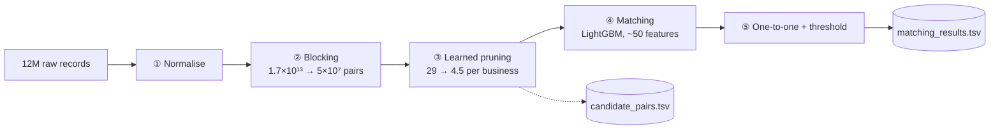

# 2 · How the pipeline works

[← 1 · The problem](1-the-problem.md) · Next: [3 · Results and lessons →](3-results-and-lessons.md)

Each stage is a command in [`src/pipeline.py`](../src/pipeline.py) and saves its output to disk. If Colab disconnects, you restart from the last finished stage.

---

## ① Normalise: make every record comparable
**File:** [`src/normalize.py`](../src/normalize.py)

| Step | Before | After |
|---|---|---|
| Lower-case, remove accents | `Élan Café` | `elan cafe` |
| Transliterate Indian scripts | `कंसल्टेंसी` | `kansaltensi` |
| Remove legal and noise words | `Sri Balaji Traders Pvt Ltd` | `balaji traders` |
| Website names | `teamair.com` | `teamair` |
| Canonical abbreviations | `12 Anna Salai ROAD` | `12 anna salai rd` |
| Drop state/region segments | `…, Chennai, Tamil Nadu` | `… chennai` |
| Leading zeros, glued words | `0044023`, `339Nehru` | `44023`, `339 nehru` |
| Sound code | `consultancy` / `kansaltensi` | `knsltns` / `knsltns` |

**Why it's fast:** the work is done with Apache Arrow compute kernels, which process whole columns in C++ at once. 12M rows take about 10 minutes on 2 cores, where a Python `for` loop would take hours.

---

## ② Blocking: decide which pairs are worth comparing
**File:** [`src/blocking.py`](../src/blocking.py)

Comparing every Source-1 record with every Source-2/3 record means **1.7 × 10¹³ pairs**. Blocking only compares records that share at least one **rare key**:

| Key type | Example for "Davis Family Office, 88 Olive Circle" |
|---|---|
| name word · name pair | `davis` · `davis + family` |
| name without spaces | `davisfamilyoffice` |
| prefix pair (survives typos) | `davi + fami` |
| name + house number | `davis + 88` |
| **house number + street word** (works when the name is garbage) | `88 + olive` |
| number pair | `12 + 190` |
| name prefix + address prefix | `davi + oliv` |
| sound word / pair / + number | `knsltns`, `knsltns + 12` |

Then:
1. **Block purging.** A key shared by more than 15 Source-1 records or 150 Source-2/3 records is dropped; "private" or "88 + road" would create millions of useless pairs.
2. **Weighted meta-blocking.** Every shared key adds `type_weight / log₂(2 + block size)`. Each business keeps its **top 30** partners by total weight.

**Memory trick:** Source-1 keys are built first. Source-2/3 records are processed in chunks, and only keys that also exist in Source 1 are kept. The whole stage uses integer arrays, never Python objects.

**Result (test):** 50.4M pairs (29 per business) that still contain **93.6%** of all true matches.

---

## ③ Learned pruning: 29 → 4.5 candidates
**File:** [`src/pipeline.py`](../src/pipeline.py) (`STAGE 1`)

A small, fast LightGBM model scores every blocking pair using cheap signals: blocking score, ranks, and 4 quick string similarities. Its cut-off is chosen on validation data to keep **99.5%** of the reachable true matches, with at most 10 per business.

That shrinks `candidate_pairs.tsv` from 24.3 to **4.46 per business**, 5.4× smaller. The recall ceiling moved only from 0.936 to 0.931.

---

## ④ Matching: the real decision
**File:** [`src/features.py`](../src/features.py)

About 50 numbers describe each candidate pair:

| Group | Examples |
|---|---|
| Name | ratio, token-set, token-sort, partial, Jaro-Winkler, no-spaces ratio, sound-code similarity |
| Address | token-set on the full address, the street-only part and the numbers only; house-number equality |
| Frequency | how many records share this exact name or address (a unique name is strong evidence; a busy building is weak) |
| Context | blocking score, rank within the business, rank within the record |
| **Competition** | the stage-1 probability, and the best probability *another* business has for the same record |

A **LightGBM** classifier (812 trees) turns these into a match probability. Country is **not** a feature, so France is handled like any other country.

---

## ⑤ One-to-one assignment and threshold
Source 1 has no duplicates, so each Source-2/3 record can belong to **at most one** business. It is kept only for the business where its probability is highest, and only if that probability is above the threshold chosen on validation.

---

## The metric in code
[`src/metrics.py`](../src/metrics.py) implements macro F0.5 exactly as the challenge defines it, including singletons and true pairs lost during blocking. It was checked against a simple set-based reference implementation.
