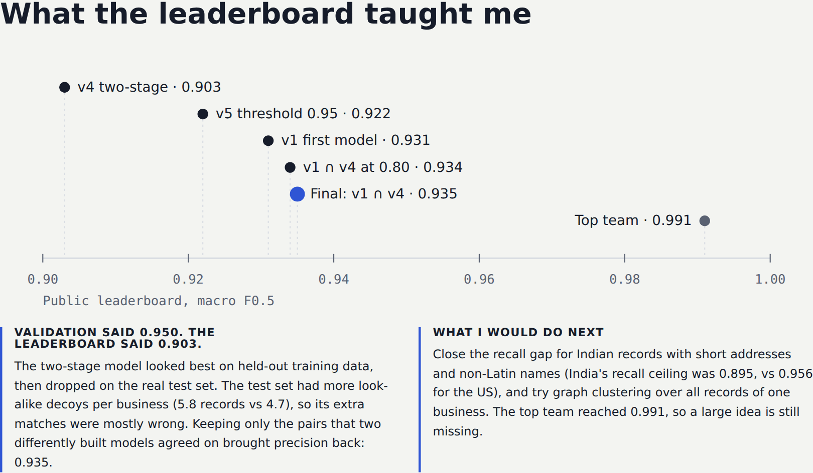
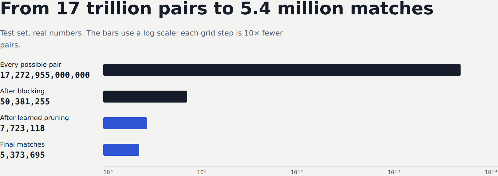

# 3 · Results and lessons

[← 2 · How it works](2-how-it-works.md) · Next: [4 · Run it yourself →](4-run-it-yourself.md)

## Every submission
| Version | What changed | Candidates / business | Validation F0.5 | Public leaderboard |
|---|---|---|---|---|
| v1 | blocking (8 key types) + one LightGBM | 24.3 | 0.940 | 0.931 |
| v4 | + learned pruning, competition, frequency and phonetic features | **4.46** | **0.950** | 0.903 |
| v5 | v4 model, stricter threshold 0.95 | 4.46 | — | 0.922 |
| v1 ∩ v4 at 0.80 | agreement, with v4 stricter | 4.46 | — | 0.934 |
| **Final** | **keep only pairs both v1 and v4 predict** | **4.46** | — | **0.935** |

The top score on the leaderboard was **0.991**. I didn't make the Top 500.

## Lesson 1: a validation score is a hypothesis, not a result
v4 beat v1 on validation (0.950 vs 0.940) and then **lost** on the leaderboard (0.903 vs 0.931).

Comparing the two submission files showed why. v4 predicted **586,000 extra pairs**, about 9% more matches per business, and on the test set most of them were wrong. The test set has more Source-2/3 records per business (5.8 vs 4.7 in training), so there are more look-alike decoys. A threshold tuned on training data was too trusting on test.

**What worked:** keeping only the pairs that *two differently built models* agreed on. Each model makes different mistakes, so agreement filters out many of them.

## Lesson 2: blocking decides your ceiling
A true match that blocking never proposes can never be predicted. The best possible recall was **0.956 for the US** but only **0.895 for India**, because Indian records often have short addresses and names in other scripts. The biggest remaining gains are there, not in the model.

## Lesson 3: deciding what *not* to compare matters as much as the model
Learned pruning made the candidate set 5.4× smaller while losing only 0.4% of the reachable matches. At billion-record scale, that is the difference between feasible and impossible.

## Lesson 4: engineering hygiene is part of ML
- **Back up every output.** A Colab reset erased an overnight run, and rebuilding it cost a morning.
- **Save each stage to disk,** so a crash doesn't mean starting over.
- **Keep a version history** of every submission and the code that produced it.

## Where the errors were
| Mistake | Typical example |
|---|---|
| Wrong merge | a near-identical name at the same address (`Brightola` vs `Brightova Staffing Inc.`) |
| Wrong merge | same name, house number off by one digit (`1610` vs `161 Canal Dr`) |
| Missed match | the record has an **empty address** and a common name |
| Missed match | a trade name unrelated to the legal name (`Evowex` for `Noida Spinners Pvt Ltd`) |
| Never proposed | an Indian-script name with an address shortened to "number, city" |

## What I'd try next
1. Better blocking for short Indian addresses: address-token pairs without numbers, and full transliteration to phonetic keys.
2. A small multilingual embedding model (Apache-2.0) as an extra blocking and feature signal for trade names.
3. **Graph clustering:** all S2/S3 records of one business should also resemble *each other*.
4. Study the winning solutions to find the idea behind 0.99.
